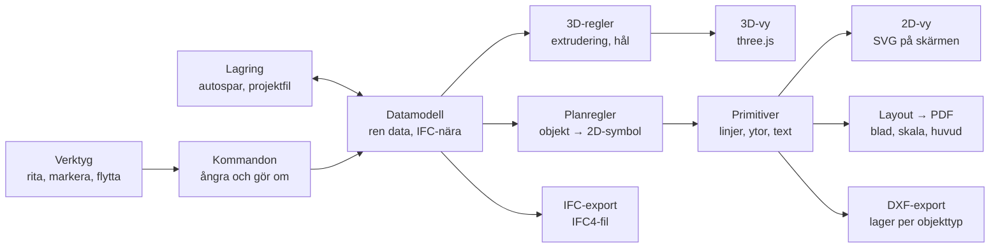

# Ritprogram för små kontor – arkitektur och demoplan

2026-10-17 · Carl August Agrell

> Dokumentet skrevs innan steg 1 påbörjades och återges här som det skrevs.
> Byggordningen har ändrats sedan dess. Hur den ser ut nu står i
> [Byggordningen nu](#byggordningen-nu) längst ned.

## Idé och avgränsning

Ett objektbaserat ritprogram i webbläsaren för små svenska kontor, där ritningen är huvudsaken. Man ritar väggar, dörrar och möbler i 2D, ser dem direkt i 3D och får ut ritningar som PDF, DXF och IFC. Modellen är objektbaserad som i ArchiCAD, men känslan ska vara SketchUps: snabb och direkt, med få inställningar.

Målgruppen är små kontor som ritar villor, tillbyggnader, ombyggnader och mindre flerbostadshus. Stora projekt med tung samordning lämnas åt Revit och ArchiCAD.

Det här ligger medvetet utanför, åtminstone i början:

- Skiktade väggar och materiallager. De ritas som 2D-detalj eller tas fram av konstruktören.
- DWG. DXF räcker.
- Samarbete i realtid och molnlagring.
- Mängdavtagning, kostnader och energiberäkning.
- Fri formmodellering, till exempel kurviga tak.
- Tak, trappor och terräng. De är viktiga men kommer efter demot.

## Grundprinciper

Sju principer styr resten av arkitekturen. Håller man fast vid dem kan delarna byggas och bytas ut var för sig.

1. **Ritningen först.** Varje objekttyp har en egen regel för hur den ritas i plan: dörrslag, fönstersymbol, väggfyllning, i svensk praxis. 3D-modellen följer av samma data.
2. **Datamodellen är ren data.** Den sparas som JSON och vet ingenting om grafik. Allt annat i programmet läser modellen.
3. **Alla ändringar går via kommandon.** Det ger ångra och gör om, autospar och möjlighet till samarbete längre fram.
4. **Ett gemensamt format för allt i 2D.** Objekten översätts till ritningsprimitiver: linjer, bågar, ytor och text, var och en med penna och linjetyp. Samma primitiver ritas på skärmen, i PDF:en och i DXF:en, så det du ser är det du får ut.
5. **Vertikala extruderingar räcker långt.** Väggar, bjälklag och rum är 2D-former som lyfts till en höjd. Ett hål för en dörr görs genom att dela väggen i bitar runt öppningen. Därför behövs ingen tung CAD-kärna i demot.
6. **Biblioteket är data.** Dörrar, fönster och möbler beskrivs i egna filer med parametrar. Nya objekt kan läggas till utan att röra programkoden.
7. **Bara webbläsaren.** Allt körs lokalt och ingen server behövs. Appen publiceras som statiska filer på ditt webbhotell, och en ny version gäller vid nästa omladdning.

## Moduler och dataflöde

Allt utgår från datamodellen; vyer och exporter läser bara.



Verktygen ändrar aldrig modellen direkt. De skickar kommandon. Vyer och exporter läser bara modellen, och samma primitiver blir både skärmbild, PDF och DXF.

Mappstrukturen följer modulerna, så varje del kan byggas om för sig:

```
src/
  core/       modell, kommandon, ångra, händelser
  geometry/   väggskarvar, öppningar, polygoner
  repr/       planregler → primitiver, 3D-regler → mesh
  view2d/     SVG-ritning, kamera, snäpp
  view3d/     three.js-scen, markering
  tools/      vägg, öppning, möbel, mått, markera
  library/    dörrar, fönster, möbler (JSON)
  layout/     blad, vyfönster, ritningshuvud
  export/     pdf, dxf, ifc
  storage/    autospar, projektfil
  ui/         paneler och verktygsfält
```

## Datamodellen

Modellen följer IFC:s hierarki men har färre fält: Projekt → Byggnad → Våningsplan → objekt. Alla mått anges i millimeter, och koordinaterna gäller per våningsplan. Varje objekt får ett beständigt id.

| Objekt i appen | IFC-motsvarighet | Viktigaste egenskaper |
| --- | --- | --- |
| Vägg | IfcWall | start, slut, tjocklek, höjd, placering mot linjen (mitt/vänster/höger) |
| Dörr | IfcDoor + IfcOpeningElement | värdvägg, avstånd längs väggen, bredd, höjd, slagriktning |
| Fönster | IfcWindow + IfcOpeningElement | värdvägg, avstånd, bredd, höjd, bröstningshöjd |
| Bjälklag | IfcSlab | kontur, tjocklek |
| Rum | IfcSpace | namn, nummer, kontur (räknas ut från väggarna), area |
| Möbel | IfcFurnishingElement | biblioteksobjekt, position, rotation |
| Mått, text, 2D-linje | ingen (ritningsinformation) | våningsplan, geometri, text |

Mått, text och 2D-linjer hör till våningsplanet men märks som ritningsinformation. De följer alltså inte med till IFC.

Så här kan en vägg och en dörr se ut i projektfilen:

```json
{
  "id": "w-01",
  "type": "Wall",
  "storey": "plan-1",
  "start": [0, 0],
  "end": [5000, 0],
  "thickness": 200,
  "height": 2700,
  "justification": "center"
}
{
  "id": "d-01",
  "type": "Door",
  "host": "w-01",
  "offset": 1200,
  "width": 900,
  "height": 2100,
  "swing": "left",
  "side": "in",
  "library": "dorr-enkel"
}
```

Dörren känner bara till sin vägg och sin plats längs den. Flyttar man väggen följer dörren med.

## Tillstånd, förslag och lager

Utöver sin geometri har varje objekt två egenskaper: i vilka tillstånd det finns, och egna taggar. Åtgärden (befintligt, rivs, nytt) anges aldrig, den räknas ut. Lagren räknas sedan ut från åtgärd, objekt och del med regler, så ingen behöver välja lager när man ritar.

**Tillstånd i stället för åtgärder.** Projektet har en lista med tillstånd, till exempel *Befintligt*, *Förslag A* och *Förslag B*. Varje objekt har en kryssruta per tillstånd som anger var det finns. Man markerar objekten i planen och kryssar i egenskapspanelen i vilka tillstånd de finns.

**Åtgärden räknas ut** när en vy jämför två tillstånd, oftast ett förslag mot Befintligt:

| Finns i Befintligt | Finns i förslaget | Åtgärd i förslaget |
| --- | --- | --- |
| ja | ja | Befintligt, oförändrat |
| ja | nej | Rivs |
| nej | ja | Nytt |

Samma vägg kan alltså rivas i förslag A och stå kvar i förslag B utan att något säger emot sig självt. Eftersom dörrar och fönster är egna objekt blir en ny dörr i en befintlig vägg automatiskt en ny öppning, bara i det förslaget. Ett befintligt objekt som flyttas blir ett rivet och ett nytt.

**Förval när man ritar.** Man arbetar alltid i ett aktivt tillstånd. Det man ritar i Befintligt kryssas i Befintligt och i alla förslag, eftersom det befintliga finns kvar tills någon river det. Det man ritar i ett förslag kryssas bara där. Ett nytt förslag kan skapas som kopia av ett annat. Vid nybyggnad finns inget Befintligt och allt blir nytt.

Samma modell klarar etapper. Etapp 2 jämförd med Etapp 1 visar det som rivs och byggs mellan etapperna.

**Vyer.** Varje vy väljer vilket tillstånd som visas, vilket det jämförs med och visar varje åtgärd med grafiken från projektets stilmall. Förvalet är svensk praxis: väggar med svart kontur och vit fyllning (poché är ett eget val), rivs streckat utan fyllning, nytt med snedställd skraffering, befintliga dörrar 30° öppna, igensatta dörrhål som nytt väggmaterial och nya öppningar i befintlig vägg med en skrafferad zon på var sida. Stilmallen kan ändras och sparas som fil. Vyn anger också vilka taggar som döljs. Det ersätter ArchiCADs ombyggnadsfilter och lagerkombinationer.

**Lager som regler.** Varje ritningsprimitiv vet vilket objekt den kommer från, vilken del den är och vilken åtgärd den har i vyn. En väggs delar kan vara snittkontur och fyllning, en dörrs blad, slagbåge och karm. En lagerprofil är en tabell med regler som ger lagernamn, penna och linjetyp. Standardprofilen följer SB11, och kontoret kan kopiera den eller göra egna. I appen visas lagren ändå som vanligt, med öga och lås.

| Objekt | Del | Status | Exportlager (påhittat exempel) |
| --- | --- | --- | --- |
| Vägg | Snittkontur | Nytt | A-Vägg-Ny-Kontur |
| Vägg | Fyllning | Nytt | A-Vägg-Ny-Fyllning |
| Vägg | Snittkontur | Befintligt | A-Vägg-Bef-Kontur |
| Dörr | Slagbåge | alla | A-Dörr-Symbol |
| Möbel | alla | alla | A-Inredning |

**Taggar** är egna etiketter för specialfall, till exempel "utredning". En regel kan fånga en tagg och lägga den på ett eget lager.

I projektfilen blir det två fält till per objekt: `"states": ["bef", "a"]` och `"tags": []`. Vid IFC-export kan den uträknade åtgärden skrivas i objektets Status-egenskap. Fälten finns i modellen från början, även om gränssnittet för dem byggs efter demot.

## Guiden för nytt projekt

Ett nytt projekt startar i ett kort formulär på en enda skärm. Fyra fält krävs. Resten fylls i automatiskt eller ligger under *Fler inställningar*, och allt går att ändra senare.

| Fält | Krävs | Vad det ställer in |
| --- | --- | --- |
| Projektnamn | ja | Ritningshuvud och filnamn |
| Projekttyp: nybyggnad, tillbyggnad, ombyggnad | ja | Om tillståndet Befintligt skapas och vilka vyer som skapas, till exempel rivningsplan vid ombyggnad |
| Plats: adress eller punkt på karta | ja | Koordinatsystem, höjdsystem, terräng och höjdkurvor via höjdkurvor.se |
| Ritningsstandard | ja, förvald | Lagerprofil, ritningsnumrering och ritningshuvud |
| Beställare | nej | Ritningshuvud |
| Våningsplan och nivåer | nej, ett plan som förval | Skapar våningsplanen |
| Kontorsuppgifter | anges en gång i kontorsprofilen | Logga, adress och ansvarig i ritningshuvudet |

I demot ingår projektnamn och projekttyp, och de fyller ritningshuvudet. Platsen och kopplingen till höjdkurvor.se kommer efter demot.

## Bibliotek, komponenter och förteckningar

Biblioteksobjekt och komponenter bygger på samma mekanism: en **definition** beskriver hur något ser ut och vilka parametrar det har, och en **instans** placerar det i modellen med sina egna värden. Skillnaden är bara var definitionen ligger.

| | Definitionen ligger | Ändras definitionen |
| --- | --- | --- |
| Biblioteksobjekt (dörr, fönster, soffa) | I en egen fil i ett bibliotek. En kopia följer med in i projektfilen | Projektet erbjuder att uppdatera till den nya versionen |
| Komponent (hotellrum, badrumsmodul, trapphus) | I projektfilen | Alla instanser uppdateras direkt |

**Biblioteksobjekt som egna filer.** Varje objekt är en fil med parametrar (bredd, höjd, karmdjup), typer (namngivna förval som "Innerdörr M9×21"), egenskaper (öppningssätt, hängning, brandklass, ljudklass) och regler för hur objektet ritas i plan, i vy och i 3D. Reglerna skrivs som enkla uttryck, till exempel `bredd - 2 * karm`, och inte som programkod. Det gör objekten säkra att dela, och de kan skapas i en separat objektredigerare. Projektfilen bär med sig kopior av de objekt den använder, så den fungerar även utan biblioteket.

**Komponenter i samma fil.** En grupp av objekt kan göras om till en komponent, som i SketchUp. Ändrar man en instans ändras alla. En instans kan speglas och roteras, och kan göras unik om den ska avvika. Allt ligger i samma projektfil, till skillnad från ArchiCADs hotlink-moduler.

**Förteckningar som vyer.** En förteckning är en vy av modellen i tabellform, precis som en plan är en vy i ritningsform. Den väljer objekttyp och filter (våningsplan, tillstånd), kolumner och summering. Förhandsbilden av en dörr eller ett fönster ritas från objektets egen vy-regel, med samma primitiver som allt annat. Därför kan förteckningar placeras på ritningsblad, exporteras som PDF och tas ut som kalkylblad.

| Förteckning | Exempel på kolumner |
| --- | --- |
| Rumslista | Nummer, namn, area, summa per våningsplan |
| Dörrförteckning | Förhandsbild, typ, mått, öppningssätt, hängning, brandklass, ljudklass, antal |
| Fönsterförteckning | Förhandsbild, typ, mått, öppningsbarhet, U-värde, antal |

Egenskaperna lagras i grupper som motsvarar IFC:s egenskapsuppsättningar, till exempel Pset_DoorCommon. Då följer de med till IFC-exporten utan extra arbete.

För demot skriver vi biblioteksobjekten för hand i filformatet. Objektredigeraren kommer efter demot.

## Teknikval

Teknikvalen hålls små och vanliga, så att det finns gott om exempel och hjälp att hitta.

| Del | Val | Varför |
| --- | --- | --- |
| Språk och bygge | TypeScript + Vite | Typkontrollen fångar fel tidigt och omladdningen går snabbt |
| Gränssnitt | Vanlig TypeScript eller Preact | Litet och utan tungt ramverk |
| 2D-vy | SVG i demot, Canvas senare vid behov | Enkelt att klicka och markera i. Tack vare primitivlagret är det billigt att byta |
| 3D-vy | three.js | Standardvalet, med stort community |
| 2D-geometri | polygon-clipping eller en Clipper-port | Unioner och klippning för väggskarvar och rum |
| PDF | jsPDF eller pdf-lib | Vektorlinjer, text, skalenlig utskrift |
| DXF | Egen skrivare | DXF är text. R2000-formatet klarar fyllningar (HATCH) och polylinjer |
| IFC | Egen IFC4-skrivare eller web-ifc | Några få entitetstyper räcker i början |
| Lagring | Webbläsarens privata filsystem (OPFS) + Spara som-fil | Autospar lokalt och en projektfil som går att mejla |
| Installation och offline | vite-plugin-pwa | Appen kan installeras och fungerar utan nät |
| Driftsättning | Statiska filer på eget webbhotell | Samma upplägg som terrängappen |

## Demots omfattning

Demot ska visa hela kedjan från rita till exportera, men för ett enda våningsplan. Datamodellen hanterar flera våningsplan från början, så fler plan kan läggas till senare utan omtag. När allt nedan fungerar är demot klart.

- [ ] Ett våningsplan i mm med rutnät, panorering och zoom
- [ ] Rita väggar med klick, ortogonalläge och inskriven längd, som i SketchUp
- [ ] Snäpp till ändpunkter, mittpunkter och vinkelräta lägen
- [ ] Väggskarvar (L, T, kors) som löses automatiskt i plan och 3D
- [ ] Placera dörrar och fönster i en vägg, flytta dem längs väggen och vänd slaget
- [ ] Några möbler (säng, soffa, bord, köksbänk) med 2D-symbol och enkel 3D-form
- [ ] Markera i 2D eller 3D och ändra mått i en egenskapspanel, med ändringen synlig direkt i båda vyerna
- [ ] Live-3D där man kan snurra, panorera och zooma
- [ ] Rum med automatisk area, rumslista och dörr- och fönsterförteckning
- [ ] Linjära mått och text
- [ ] Ett A3-blad med en planvy i 1:50 eller 1:100 och ett enkelt ritningshuvud
- [ ] Export av bladet som PDF, planen som DXF och modellen som IFC
- [ ] Ångra och gör om, autospar, spara och öppna projektfil

## Byggordning

Tolv milstolpar i ordning. Varje steg slutar med något man kan klicka på i webbläsaren, och appen ligger publicerad från första steget. Steg 3 och 6 är tyngst.

1. **Skelett.** Vite och TypeScript, PWA och en tom 2D-vy med rutnät, panorering och zoom. Namn och logga i en konfigurationsfil. Klart 17 oktober.
2. **Kärnan.** Datamodell med tillstånd och taggar, definitioner och instanser, egenskaper, kommandon, ångra och gör om, autospar. Klart 17 oktober, med exempelprojektet som ombyggnad med två förslag.
3. **Väggverktyget.** Rita, snäppa och skriva in längd. Väggskarvarna löses i plan. Klart 17 oktober, tillsammans med markering, egenskapspanel, typer med littera och stilmallar.
4. **3D-vyn.** Väggarna extruderas och följer varje ändring direkt. Klart 17 oktober: 3D, plan eller båda sida vid sida, öppningar i rätt höjd, markering i 3D.
5. **Markering och egenskapspanel** i 3D-vyn. I plan finns de redan sedan steg 3.
6. **Dörrar och fönster.** Parametriska biblioteksobjekt i biblioteksformatet. De sitter i sin vägg, med öppningar i 3D och symboler i plan.
7. **Möbler** och komponenter som uppdateras överallt.
8. **Rum, mått och text.**
9. **Förteckningar.** Rumslista med summering och dörr- och fönsterförteckning med förhandsbild.
10. **Layout och PDF.** Blad, vy i skala och ritningshuvud.
11. **DXF-export** med lager enligt lagerreglerna.
12. **IFC-export.** Kontrolleras genom att filen öppnas i ArchiCAD och i en gratis IFC-visare.

## Hur nya funktioner läggs till

Listan ovan är en början. Funktioner kommer att läggas till, ändras och bytas ordning på, och programmet är byggt för det:

- **Ny objekttyp** (trappa, tak, terräng): en ny fil i `src/elements/` och en rad i registret. Ångra, autospar, filformat, tillståndstabellen och jämförelsegrafiken fungerar direkt.
- **Ny vy eller export** (3D, sektion, IFC): en ny valfri regel på elementtyperna. En typ som saknar regeln syns inte i den vyn, så inget går sönder medan regeln byggs ut typ för typ.
- **Ändrat filformat**: formatversionen höjs och en migrering läggs till. Gamla projekt öppnas alltid, och objekt som en äldre version inte känner till ligger kvar orörda.
- **Ny ändring av modellen**: ett nytt kommando. Alla ändringar går genom kommandon och blir ett ångra-steg var.

Skiktningen är strikt: kärnan vet ingenting om ritning eller gränssnitt. Reglerna står i [`docs/UTVECKLING.md`](UTVECKLING.md) i koden.

## Svenska anpassningar efter demot

Det som gör appen svensk kan byggas på steg för steg ovanpå demot. Standardnamnen nedan är tagna ur minnet och bör kontrolleras.

- Lagernamn i DXF enligt SB11, så att konsulter känner igen lagren
- Ritningsnummer och ritningshuvud enligt Bygghandlingar 90
- Areor (BOA, BRA, BTA) enligt SS 21054
- Svenska plansymboler för dörrar, fönster, kök och våtrum
- Bygglovsritningar: fasader, sektioner och situationsplan
- Import av höjdkurvor och terräng från terrängappen
- Tak, trappor och flera våningsplan

## Risker och beslut

Den största tekniska tröskeln efter demot är att ta fram fasader och sektioner med dolda linjer ur 3D-modellen. Under själva demot är det väggskarvarna som tar mest tid.

- **Väggskarvar.** Sneda vinklar, olika tjocklekar och många väggar i samma punkt ger fler specialfall än man tror.
- **Filhantering.** Full åtkomst till lokala filer finns i Chrome och Edge, men inte fullt ut i Safari och Firefox.
- **DXF-kompatibilitet.** Exporten bör testas tidigt mot ArchiCAD och DWG TrueView.
- **Prestanda.** Problemen märks först med många objekt. Primitivlagret gör det möjligt att byta SVG mot Canvas utan att röra resten.

Beslut:

- [x] Motorn får ett internt kodnamn, Bacchus. Produktnamn, logga och domän ligger i en konfigurationsfil och kan bytas när som helst
- [x] Öppen källkod
- [x] Egen IFC4-skrivare. web-ifc kan läggas till om IFC-import behövs senare
- [x] Demot är publikt i en mapp på agrellarkitektur.se, med låtsasbranding
- [ ] Produktnamn och domän. cad-apa.se är kandidat
- [ ] Licens: MIT eller GPL

---

## Byggordningen nu

*Uppdaterad 2026-10-18.* Ordningen ovan har ändrats under arbetet. Steg 5 i
dokumentet blev en del av steg 4, och dörrar, fönster, rum, mått och text
byggdes tillsammans som steg 5. Vad varje version innehåller står i
[README](../README.md).

1. **Skelett.** Klart.
2. **Kärnan.** Klart.
3. **Väggverktyget**, med markering, egenskapspanel, typer med littera och stilmallar. Klart.
4. **3D-vyn**, med markering och redigering i 3D. Klart.
5. **Dörrar, fönster och anteckningar**: dörrar och fönster med typer och littera, rum med numrering, mått och text. Klart, och utbyggt i 0.6–0.6.2 med vyer, detaljnivåer, navigator och tillfälliga mått. Dörrar och fönster är ännu inte biblioteksobjekt i egna filer.
6. **Ritningsblad och PDF.** Blad med ritningshuvud och vyer i skala, utskrift till PDF. Hit hör också:
   - underlag att rita över: DXF, PDF och bilder
   - arbetsblad: fria 2D-ritningar som inte hör till en våning
   - autotext
   - typsnitt och textformatering
   - littera som går att flytta
   - annoteringsskala per vy
7. **Förteckningar.** Rumslista med summering och dörr- och fönsterförteckning med förhandsbild. Hit hör också ytskikt som styrs av rumsobjektet.

Kvar från dokumentets ordning, med nummer och ordning ännu inte bestämda:

- **Möbler, biblioteksobjekt och komponenter**, inklusive dörrar och fönster i biblioteksformatet
- **DXF-export** med lager enligt lagerreglerna
- **IFC-export**
